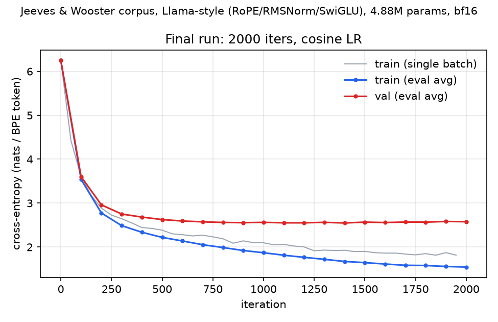
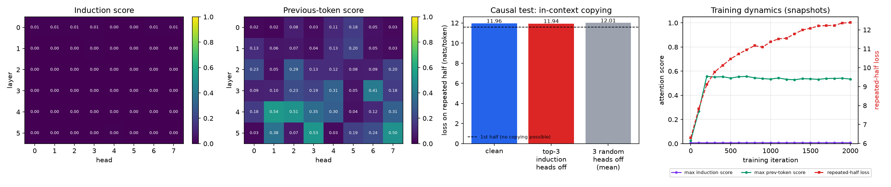
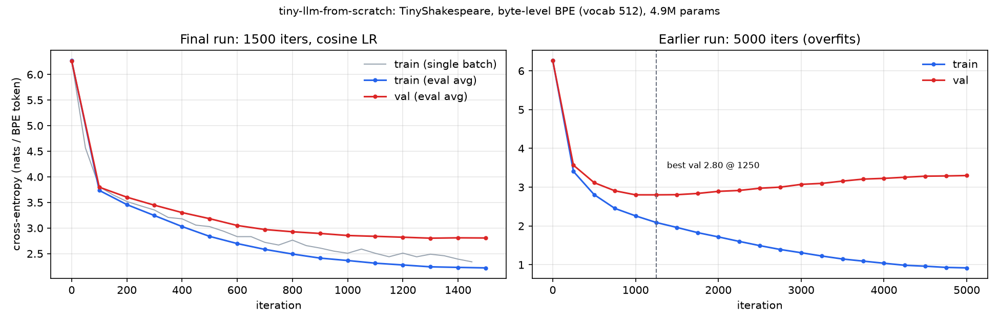

# tiny-llm-from-scratch

A small decoder-only language model built from scratch in PyTorch. It includes a byte-level BPE tokenizer, causal multi-head attention, GPT-2-style and Llama-style transformer blocks (RoPE, RMSNorm, SwiGLU), a KV cache, bf16 training, a sampler, and a mechanistic-interpretability toolkit. It uses no Hugging Face model classes: only `torch.nn` primitives (`Linear`, `Embedding`, `LayerNorm`, `Dropout`) come from the library.

It trains on a laptop GPU in about 4 minutes. Two corpora are supported:

| corpus | model | held-out perplexity | bits / char | train time |
|---|---|---|---|---|
| **Jeeves & Wooster** (P.G. Wodehouse, 1.46M chars) | Llama-style, 4.88M params | **12.89** | **1.81** | 3.8 min |
| TinyShakespeare (1.1M chars) | GPT-2-style, 4.94M params | 16.58 | 2.16 | 4.6 min |

Every number in this README is measured. Raw logs, histories and evaluation JSON are in [`runs/`](runs/). The two rows use different text, so compare within a row, not across rows.

## It talks like Bertie Wooster

Real output from `sample.py` (temperature 0.8, top-k 40, seeds 1–4, not cherry-picked; all four are in [`runs/jeeves_samples.txt`](runs/jeeves_samples.txt)):

```
"Jeeves," I said, "it would be a bit of a chappie whose words I will
paint there?"

"I hope they are. How are you doing anything?"

Jeeves started giving me the chappie out of my shock.

"Sir?"

"Nothing like that."

"Oh, all right, then. You mustn't want to make an impression. I mean,
Bingo isn't very bally awful dozen.
```
```
Aunt Agatha had ready for the proceedings I had never heard of
the first day, and then the Glossop came away from the back.

"What ho!"

"I didn't do anything that. They must be allowed in a way."
```
```
"Very good, sir."

"Well, by Jove, what I mean is, I think that particularly against the
thing that was the longest fashional failed to be pretty brainy.

"Do you mean to say, sir?"
...
"Carry on."
```

The model has learned Wodehouse's register ("What ho!", "by Jove", "bally", "chappie", "I mean"), the cast (Jeeves, Aunt Agatha, Bingo, Glossop, Freddie), and the rhythm of a Bertie/Jeeves exchange ("Sir?" / "Very good, sir."). It hasn't learned to stay coherent across a sentence, which is expected at 5M parameters and 0.6M training tokens.

**Data:** *My Man Jeeves* (1919), *The Inimitable Jeeves* (1923), *Carry On, Jeeves* (1925) and *Very Good, Jeeves* (1930), all public domain in the USA, from Project Gutenberg. `prepare_data.py --corpus jeeves` downloads them and cuts each book at pinned story boundaries, so title pages, publisher ads and transcriber notes are dropped. It also normalizes typographic quotes and dashes. The text is not committed to this repo. The validation set is the last 10% of the corpus, which is the closing stories of *Very Good, Jeeves*, so the model has never seen those stories.



## Architecture

```
token ids (B, T)
   │
   ├─ token embedding (512 × 256) ──────────────── shared with the output head (weight tying)
   └─ learned position embedding   [gpt2 preset only; llama uses RoPE inside attention]
   ▼
┌──────────────────── Block × 6 ────────────────────┐
│ x = x + Attn(Norm(x))      Norm: LayerNorm | RMSNorm                │
│ x = x + MLP(Norm(x))       MLP:  GELU 4x   | SwiGLU (8/3x, param-matched) │
└───────────────────────────────────────────────────┘
   ▼ final Norm → logits = x · Wₑᵀ → cross-entropy on the next token
```

Every difference between GPT-2 and Llama is a switch in `GPTConfig`, so the two can be compared under an identical budget:

| component | `--arch gpt2` | `--arch llama` (default) |
|---|---|---|
| positions | learned absolute embedding | rotary embeddings (RoPE) on q and k |
| normalization | LayerNorm (with bias) | RMSNorm |
| MLP | Linear → GELU → Linear (4×) | SwiGLU gate (hidden = 8/3·d, same parameter count) |
| biases | yes | none |

**Attention** (`tinyllm/model.py`) has two interchangeable paths, and tests check that they agree:
- an explicit reference path: `softmax(QKᵀ/√d + causal mask) V`
- a fused path: `F.scaled_dot_product_attention`

The attention module can also record its attention maps and switch off individual heads; `interpret.py` uses both.

**KV cache:** `generate()` prefills the prompt once, then each new token runs a single position against the cached keys and values. When the context fills up, the cache is rebuilt from the most recent half-window.

**Tokenizer** (`tinyllm/tokenizer.py`): byte-level BPE in about 100 lines. A GPT-2-style regex pre-splits the text, so merges never cross word boundaries. Each chunk starts as raw UTF-8 bytes, so any string can be encoded and decoding is lossless. Pairs are counted over unique chunks weighted by frequency, so training 256 merges on 1.3 MB takes about 14 seconds in pure Python.

**Training** (`train.py`):
- AdamW with β = (0.9, 0.95), weight decay applied to matrices only
- linear warmup, then cosine decay
- gradient clipping at a global norm of 1.0
- bf16 autocast on CUDA, about 2.4× faster than fp32 here
- periodic evaluation, keeping the checkpoint with the best validation loss
- optional training snapshots for later analysis

## Interpretability: do induction heads form?

Induction heads are attention heads that let a transformer copy from its context: "A was followed by B earlier, so predict B after this A" (Elhage et al. 2021; Olsson et al. 2022). `interpret.py` measures three things:
- **Induction and previous-token scores.** It feeds sequences of random tokens repeated twice, `[x₁…x₁₀₀, x₁…x₁₀₀]`. A head's induction score is its average attention from each position in the second half to the token that followed that position's earlier occurrence. Its previous-token score is its average attention to the immediately preceding position.
- **A causal test.** It switches off the top-3 induction heads and compares that with switching off 3 random heads (the mean of 20 random draws).
- **Training dynamics.** It repeats the measurements on 21 snapshots saved every 100 iterations.



Results for the Jeeves model (from [`runs/jeeves_interpretability.json`](runs/jeeves_interpretability.json)):

| measurement | value |
|---|---|
| max previous-token score | 0.03 at iteration 0, **0.56 at iteration 200**, then flat around 0.54 |
| max induction score | **≤ 0.009 at every snapshot** (chance is about 0.007) |
| loss on repeated random tokens, first half → second half | 11.58 → 11.96 (no gain from having seen the sequence) |
| loss on a repeated natural Jeeves passage, first → second | 2.63 → 2.71 (no gain) |
| repeated-half loss: clean / top-3 "induction" heads off / 3 random heads off | 11.96 / 11.94 / 12.01 |
| val loss: clean / top-3 heads off / 3 random heads off | 2.556 / 2.558 / 2.564 |

So **half of the induction circuit forms and half doesn't.** Previous-token heads appear within the first 200 steps, mainly in layers 4 and 5. The second step, attending to "the token after my earlier occurrence", never appears within this budget of about 33M training tokens. The causal test agrees: switching off the highest-scoring candidate heads hurts no more than switching off random heads. That fits the published finding that induction heads form in a later phase change than this run reaches.

The loss on random tokens *rises* during training (6.3 → 12.4). The model becomes more confident about real English, so random token strings look increasingly surprising to it.

One methodology note: random tokens are drawn only from tokens that occur at least 100 times in the training data. An earlier version sampled from the whole vocabulary, which included byte tokens never seen in training, and the model's loss on those was about 15 nats. That measured unfamiliar input, not copying.

## KV cache speedup

Measured with `bench_generate.py` on the Jeeves model: batch size 1, top-k sampling, the mean of 3 runs after a warm-up.

| device | tokens generated | no cache | KV cache | speedup |
|---|---|---|---|---|
| CPU | 240 | 69.9 tok/s | 173.6 tok/s | 2.5× |
| CPU | 1000 | 47.3 tok/s | 175.7 tok/s | **3.7×** |
| GPU (RTX 5050 laptop) | 240 | 70.9 tok/s | 109.8 tok/s | 1.5× |
| GPU (RTX 5050 laptop) | 1000 | 92.6 tok/s | 105.3 tok/s | 1.1× |

Without a cache, each new token re-runs the model over the whole context, so the cost per token grows as the context fills. With the cache, the cost per token stays flat. On the GPU the gain is small because at batch size 1 a 5M-parameter model is limited by per-step overhead, not by computation. That's why the CPU with a cache beats the GPU here.

## Architecture ablation (GPT-2 → Llama, one switch at a time)

`ablate.py` trains four variants on TinyShakespeare with three seeds each, using identical data, model size, optimizer and 1500-step budget, and scores every best checkpoint on the full validation split. **This run is still in progress; the results table will be added here when it finishes.**

```bash
python ablate.py --seeds 1 2 3     # writes runs/ablation/summary.md and assets/ablation.png
```

## TinyShakespeare baseline (GPT-2 style)

The original model: 4,935,680 parameters, fp32, 1500 iterations in 4.6 minutes. Full-split validation loss is 2.808 (perplexity 16.58, 2.16 bits per character); train loss is 2.248.

```
ROMEO:
Hark, what comes offort?

MERCUTIO:
My lord, he's abroad?

Nurse:
No fair Signior Jove, tell me to go to him;
I could not have the cold, I must find again.
```



An earlier 5000-iteration run (right panel) overfit badly. Validation loss bottomed out at 2.80 around iteration 1250 and then rose to 3.30, while training loss fell to 0.92. Ending the cosine schedule at 1500 iterations reached the same best validation loss in a third of the time.

## How to run

```bash
python -m venv .venv && .venv\Scripts\activate       # Linux/macOS: source .venv/bin/activate
pip install -r requirements.txt                       # for CUDA, install torch from pytorch.org first
python -m pytest                                      # 34 tests, about 6 s on CPU

python prepare_data.py --corpus jeeves                # or --corpus shakespeare (default)
python train.py --data_dir data/jeeves --out_dir out/jeeves --max_iters 2000 --save_every 100
python evaluate.py --ckpt out/jeeves/ckpt.pt --data_dir data/jeeves
python sample.py --ckpt out/jeeves/ckpt.pt --tokenizer data/jeeves/tokenizer.json --prompt "What ho!"

python interpret.py --ckpt out/jeeves/ckpt.pt --data_dir data/jeeves \
    --snapshots out/jeeves/snapshots --history out/jeeves/history.json
python bench_generate.py --ckpt out/jeeves/ckpt.pt
python ablate.py --seeds 1 2 3
```

`train.py` flags:
- `--arch gpt2|llama` picks a preset, and `--pos_emb`, `--norm` and `--mlp` override single components.
- `--device auto|cpu|cuda`, `--dtype auto|fp32|bf16`, `--attn sdpa|manual`.

The defaults are 6 layers, 8 heads, d = 256, a 256-token context, batch size 64, dropout 0.25, learning rate 1e-3 decaying to 1e-4, and 100 warmup steps. The RTX 5050 (Blackwell) needs a CUDA 12.8+ build of PyTorch; this repo used `torch 2.14.1+cu130`. CUDA runs aren't bitwise reproducible, so expect small differences from the tables.

## Tests

The 34 tests in `tests/` run every combination of architecture (gpt2, llama) and attention path (manual, SDPA) where it matters:
- **Causality:** changing token *t* leaves the logits before *t* exactly unchanged, and the gradient from output *t* to any later input is exactly zero.
- **KV cache:** prefill plus one-token decode steps gives the same logits as a full forward pass, and cached greedy generation produces exactly the same tokens as uncached generation.
- **Components:**
  - RoPE scores depend only on relative position, and RoPE preserves vector norms.
  - RMSNorm outputs have unit RMS.
  - SwiGLU's parameter count is within 2% of the GELU MLP's.
  - Switching off every head zeroes the attention output.
  - Recorded attention maps are causal and each row sums to 1.
- **Tokenizer:** lossless round-trips on training text, unseen text, whitespace edge cases and Unicode (emoji, CJK), and identical encodings after save and load.
- **Sanity:**
  - The initial loss is close to ln(vocab).
  - Weights are tied.
  - Generation past the context length works.
  - Top-k is respected.
  - The model can overfit a single batch.

## What I learned

- **Mechanistic claims need controls.** My first induction probe sampled byte tokens the model had never seen, so the loss was about 15 nats and the "scores" were meaningless. A pinned token pool, a natural-text probe and a random-head ablation control turned it into a clean (and honest) negative result: previous-token heads form, induction heads don't yet.
- **Caching has subtle edge cases, so pin them with tests.** `is_causal=True` in SDPA lines the mask up from the top-left corner, which is wrong when a single new query attends over cached keys. The decode step therefore runs unmasked, and the KV-cache equivalence tests (cached logits must equal full-forward logits for every architecture and attention combination) guard against regressions. Separately, a naive initial-loss test failed for the Llama preset. With tied embeddings and no position vector added to the residual stream, an untrained model already predicts "the same token as the input" better than chance. That was a flaw in the test (targets equal to inputs), not in the model.
- **Watch the overfitting curve.** On 0.5M tokens, training longer made the Shakespeare model worse. Ending the learning-rate schedule near the validation minimum matters more than the number of steps.
- **Know which resource limits you.** bf16 gave about 2.4× faster training. The KV cache gave 3.7× faster generation on CPU but only about 1.1× on GPU, because tiny models at batch size 1 are limited by per-step overhead.

## Project layout

```
tinyllm/tokenizer.py   byte-level BPE (train / encode / decode / save / load)
tinyllm/model.py       GPTConfig presets, RMSNorm, RoPE, attention (+ KV cache, hooks), SwiGLU, GPT
prepare_data.py        corpora (TinyShakespeare, Jeeves & Wooster) -> tokenizer + uint16 token files
train.py               AdamW, warmup + cosine, clipping, bf16, eval, best checkpoint, snapshots
evaluate.py            deterministic full-split loss / perplexity / bits per char
sample.py              temperature + top-k sampling (KV-cached)
interpret.py           induction / previous-token scores, head ablation, training dynamics
bench_generate.py      tokens/s with and without the KV cache
ablate.py              multi-seed architecture ablation
plot_loss.py           loss-curve figures
tests/                 pytest suite
runs/                  logs, histories, eval / interpretability / benchmark JSON
```

## License

MIT for the code. TinyShakespeare comes from Andrej Karpathy's [char-rnn](https://github.com/karpathy/char-rnn). The Wodehouse texts are public domain in the USA via [Project Gutenberg](https://www.gutenberg.org/) and are downloaded at run time, not redistributed here.
